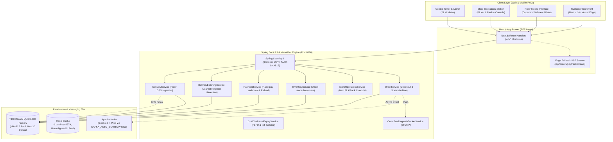
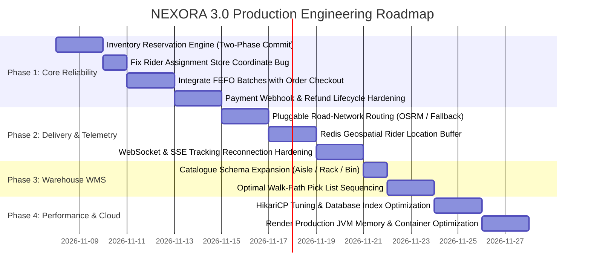

# NEXORA 3.0 — READ-ONLY ENGINEERING AUDIT & TRANSFORMATION BLUEPRINT

**Platform:** NEXORA Quick Commerce Platform  
**Audit Phase:** Phase 0 (Read-Only Deep Inspection)  
**Date:** November 7, 2026  
**Auditor:** Principal Software Architect & Reliability Engineering Team  
**Audit Scope:** Full Codebase Inspection, Git History, Database Migrations, Concurrency, Telemetry, Security, and Cloud Deployments  

---

## 1. Executive Summary & Verification Matrix

This audit represents an empirical, line-by-line inspection of the active codebase (`F:\Nexora`), existing Git history on `main`, Spring Boot 3.3.4 backend, Next.js 14 frontend, and cloud runtime configurations (Vercel & Render).

### Master Status Classification Matrix

| Dimension / Area | Audit Status | Primary Finding |
| :--- | :---: | :--- |
| **Git Working Tree** | **VERIFIED** | Clean working tree on branch `main`. Latest commit `bee33a8` (delivery flow). |
| **Backend Code Compilation** | **VERIFIED** | 370 source files & 91 test classes compile with `BUILD SUCCESS` (Java 17/21). |
| **Frontend Production Build** | **VERIFIED** | Next.js 14.2.15 compiles cleanly with 56 static/dynamic routes. |
| **Vercel Frontend Deployment** | **VERIFIED** | `https://nexora-mu-eosin.vercel.app` responds `200 OK`. |
| **Render Backend Deployment** | **BLOCKED / DEGRADED** | `https://nexora-backend-fw14.onrender.com/api/v1/health` times out (>75s cold start/hibernation on starter tier). |
| **Gap 1: Road vs Haversine ETA** | **VERIFIED (DEFICIENT)** | Haversine straight-line Euclidean distance used across `geofencing.ts` & batching. |
| **Gap 2: Rider Background GPS** | **NOT IMPLEMENTED** | Relies on browser/Capacitor geolocation. No Android native Foreground Service. |
| **Gap 3: Dark Store WMS & Pick-Path** | **PARTIALLY VERIFIED** | Basic web picker UI exists; products lack aisle/shelf/bin schema; no TSP routing. |
| **Gap 4: Connection Pool & Checkout** | **VERIFIED (BOTTLENECK)** | HikariCP capped at 20 conns; inventory permanently deducted at checkout creation. |
| **Gap 5: Dynamic Order Batching** | **PARTIALLY VERIFIED** | Rule-based Haversine batching implemented; dynamic real-time VRP missing. |
| **Gap 6: Native UPI & Refunds** | **PARTIALLY VERIFIED** | Razorpay web popup & full refund API present; native UPI intent & async webhooks missing. |
| **Gap 7: Batch Inventory & FEFO** | **PARTIALLY VERIFIED** | `inventory_batches` table & `allocateFefoStock` exist, but **checkout bypasses them completely**. |

---

## 2. Existing Architecture & Topology



---

## 3. Technology Inventory & Verification Audit

| Technology | Declared in Config | Actual Repository Implementation | Runtime Operational Status |
| :--- | :--- | :--- | :--- |
| **Java / Spring Boot** | Java 17/21, Spring Boot 3.3.4 | 370 classes, 91 test classes in `backend/` | **VERIFIED** — Clean Maven compilation |
| **Next.js / React** | Next.js 14.2.15, React 18.3.1 | 56 static & dynamic app routes in `frontend/` | **VERIFIED** — Clean `next build` |
| **MySQL / TiDB** | MySQL 8.0 / TiDB Cloud | Flyway V1 to V6 migrations | **VERIFIED** — Schema scripts present |
| **HikariCP** | Max: 20, Timeout: 20s | `application.properties` & `application-prod.properties` | **VERIFIED** — Bottleneck under concurrency |
| **Redis** | `spring.data.redis.host` | `RedisCartCacheService.java`, Redis config | **PARTIALLY VERIFIED** — Absent in `render.yaml` |
| **Apache Kafka** | `spring-kafka` | Event producers/consumers for Order, Payment | **PARTIALLY VERIFIED** — Disabled by default (`auto-startup: false`) |
| **WebSockets / STOMP** | `spring-boot-starter-websocket` | `OrderTrackingWebSocketService.java` | **VERIFIED** — Endpoints configured at `/ws-nexora` |
| **Razorpay SDK** | `razorpay-java:1.4.5` | `RazorpayGatewayClientImpl.java` | **VERIFIED** — Webhook HMAC-SHA256 implemented |
| **Elasticsearch** | `spring-data-elasticsearch` | Search document & repository classes | **PARTIALLY VERIFIED** — Disabled (`nexora.es.enabled: false`) |
| **Capacitor Mobile** | `@capacitor/core: 6.2.0` | `frontend/src/lib/mobile-bridge.ts` | **PARTIALLY VERIFIED** — Webview container only |

---

## 4. Assessment of the Seven Critical Engineering Gaps

### Gap 1: Haversine Distance vs. Road-Network ETA
- **Status:** **VERIFIED (DEFICIENT)**
- **Audit Findings:**
  1. `frontend/src/lib/geofencing.ts` computes distance using pure Euclidean spherical geometry (`calculateHaversineDistance`).
  2. Dark store service zones in Ahmedabad use static base ETAs: SG Highway (7 mins), Vastrapur (8 mins), Prahlad Nagar (8 mins), Bopal (10 mins).
  3. `DeliveryBatchingService.java` (lines 110 & 147) clusters delivery stops based on `distanceToAnchor <= proximityThreshold` using straight-line Haversine math.
  4. Real-world road distance in Indian urban environments is typically 1.4x to 1.9x greater due to one-way streets, dividers, and traffic congestion.
- **Remediation Required:** Introduce a pluggable routing provider abstraction (`RoutingEngine`) supporting **OSRM (Open Source Routing Machine)** and **Google Maps Distance Matrix**, falling back to Haversine with a road tortuosity factor only when routing APIs time out.

### Gap 2: Rider Background GPS Limitations
- **Status:** **NOT IMPLEMENTED**
- **Audit Findings:**
  1. Rider location reporting (`frontend/src/app/api/rider/location/route.ts` & `DeliveryApp.tsx`) relies on standard web browser Geolocation APIs and Capacitor Webview hooks.
  2. When an Android or iOS device enters sleep or screen-lock mode, the OS freezes background webview threads within 2–5 minutes.
  3. Every GPS ping sent to `DeliveryService.updateLocation` executes a synchronous database write (`partnerRepository.save`) AND an insert into `delivery_locations`. Under 50 active riders pinging every 5 seconds, this generates 10 writes/sec directly against the 20-connection database pool.
- **Remediation Required:**
  - Build an Android Foreground Service (Kotlin) utilizing `START_STICKY`, persistent notification, and Google Fused Location Provider.
  - Redirect high-frequency GPS telemetry off MySQL onto **Redis Geospatial (`GEOADD`)** with periodic batch flushes.

### Gap 3: Dark Store WMS & Pick-Path Optimization
- **Status:** **PARTIALLY VERIFIED**
- **Audit Findings:**
  1. Store picker screen (`frontend/src/app/store/picker/page.tsx`) and `StoreOperationsService.java` implement an item checklist and camera-based barcode scanning.
  2. The `Product` entity (`Product.java`) has **no schema fields** for `aisle`, `rack`, `shelf`, or `bin_code`.
  3. Items in an order are presented to the picker in arbitrary database order (`order_items.id` order).
  4. Pickers must crisscross the warehouse floor, destroying the 90-second picking SLA standard in quick commerce.
- **Remediation Required:** Add `aisle`, `rack`, and `bin_code` columns to the product catalogue and implement a Travelling Salesperson (TSP) heuristic sorting picking lists by optimal warehouse walking paths.

### Gap 4: Database Connection Pool & Concurrent Checkout
- **Status:** **VERIFIED (CRITICAL BOTTLENECK)**
- **Audit Findings:**
  1. `application-prod.properties` fixes HikariCP at:
     ```properties
     spring.datasource.hikari.maximum-pool-size=20
     spring.datasource.hikari.connection-timeout=20000
     ```
  2. `OrderService.checkout()` executes stock reduction immediately upon order creation (`CREATED` state) via `inventoryService.reduceStockForOrder(...)`.
  3. There is **no temporary reservation engine**. If a customer initiates checkout and delays or abandons payment, the stock is permanently deducted until an eventual cancellation occurs.
  4. A surge of 150 concurrent checkout attempts will exhaust the 20 connections within seconds, resulting in `ConnectionTimeoutException` and cascaded failure across all API endpoints.
- **Remediation Required:**
  - Implement a two-phase **Inventory Reservation Engine** (`RESERVED` with a 10-minute TTL, transitioning to `COMMITTED` on verified payment).
  - Optimize connection hold times by keeping database transactions minimal and isolating read-heavy catalog queries.

### Gap 5: Dynamic Multi-Order Batching & Route Optimization
- **Status:** **PARTIALLY VERIFIED**
- **Audit Findings:**
  1. `DeliveryBatchingService.java` contains order clustering logic (`generateBatchesForStore`) and stop sequencing (`sequenceStopsByNearestNeighbor`).
  2. However, it operates on a static snapshot of orders, uses straight-line Haversine distances for routing, and ignores rider bag volumetric capacity and vehicle weight limits.
  3. It cannot dynamically re-route or inject in-flight orders to a rider already en route.
- **Remediation Required:** Upgrade batch generation to consider package volume, delivery SLA deadlines, and road-network distance matrices.

### Gap 6: Native UPI Intent & Reliable Refund Handling
- **Status:** **PARTIALLY VERIFIED**
- **Audit Findings:**
  1. Frontend uses `https://checkout.razorpay.com/v1/checkout.js` (Web modal), which requires browser redirection or QR scanning. It does not invoke Native Android UPI Intent (`upi://pay`), which lowers mobile checkout conversion.
  2. Backend `PaymentService.java` contains `refundPayment()` which calls the Razorpay refund API synchronously, but:
     - It only supports full refunds.
     - It does not process asynchronous `refund.processed` webhooks.
     - Refunds cannot be executed on individual missing items without cancelling the entire order.
- **Remediation Required:**
  - Implement Razorpay Native UPI Intent deep-linking for mobile clients.
  - Implement item-level partial refunds and register the `refund.processed` webhook handler in `PaymentWebhookController`.

### Gap 7: Batch-Level Inventory & FEFO Expiry Management
- **Status:** **PARTIALLY VERIFIED (CRITICAL CODE DISCONNECT)**
- **Audit Findings:**
  1. Flyway migration `V6__enterprise_logistics_batching_coldchain_whatsapp.sql` correctly created the `inventory_batches` table.
  2. `ColdChainAndExpiryService.java` implements `allocateFefoStock(Long productId, Long storeId, int requestedQty)`.
  3. **THE CRITICAL BUG:** `allocateFefoStock` is **NEVER CALLED** in `OrderService.checkout()` or `InventoryService`!
  4. Checkout continues to call `inventoryService.reduceStockForOrder()`, which updates only the legacy `inventories` table (`UPDATE inventories SET quantity = quantity - ?`).
  5. The entire FEFO and perishable batch tracking system is currently dead code during customer purchases.
- **Remediation Required:** Refactor `OrderService.checkout()` and `InventoryService` to allocate stock from `inventory_batches` using FEFO (First-Expired, First-Out) ordering, ensuring expired or quarantined batches cannot be reserved.

---

## 5. Additional Critical Deficiencies Discovered

1. **Rider Assignment Origin Coordinate Defect:**
   - In `DeliveryService.java` (line 120):
     ```java
     // Store doesn't have an address directly in this phase, using customer delivery address as approximation for test
     double storeLat = order.getDeliveryAddress().getLatitude() != null ? order.getDeliveryAddress().getLatitude() : 0.0;
     double storeLng = order.getDeliveryAddress().getLongitude() != null ? order.getDeliveryAddress().getLongitude() : 0.0;
     ```
   - **Impact:** When dispatching the nearest rider, the system searches for riders nearest to the *customer's destination* rather than the *dark store pickup hub*! A rider 5 km from the store but 100 meters from the customer would be incorrectly assigned.

2. **Render Production Backend Unavailability:**
   - Probing `https://nexora-backend-fw14.onrender.com/api/v1/health` timed out repeatedly (>75 seconds).
   - On Render Starter/Free tiers, JVM instances experience excessive memory pressure (Spring Boot 3 + Hibernate + Actuator + WebSockets require 512MB–1GB RAM).

3. **Production Redis & Kafka Disconnection:**
   - `render.yaml` declares environment variables for MySQL, JWT, and Razorpay, but **omits Redis and Kafka**.
   - Redis caching and Kafka event streams are therefore inactive in production, forcing synchronous fallback behavior.

4. **Absence of Circuit Breakers for External Integrations:**
   - Calls to Razorpay, SMTP gateways, and AI endpoints lack Resilience4j circuit breakers. If Razorpay experiences upstream latency, backend threads block indefinitely until timeout.

---

## 6. Exact Files Requiring Modification

### Backend Java (`backend/src/main/java/com/nexora/`)
1. **Inventory & Reservation:**
   - `inventory/service/InventoryService.java` — Add reservation state, expiry scheduling, and FEFO batch binding.
   - `inventory/repository/InventoryRepository.java` — Add conditional atomic reservation query.
   - `inventory/entity/InventoryReservation.java` — Create new reservation entity.
   - `order/service/OrderService.java` — Switch checkout from immediate stock consumption to reservation lock.
2. **Delivery & Geolocation:**
   - `delivery/service/DeliveryService.java` — Fix store origin coordinate bug (line 120); redirect GPS writes to Redis geospatial.
   - `delivery/service/DeliveryBatchingService.java` — Integrate road-network routing distance instead of Haversine.
   - `delivery/routing/RoutingService.java` — New interface for OSRM / Google Maps distance calculation.
3. **Warehouse Operations (WMS):**
   - `product/entity/Product.java` — Add `aisle`, `rack`, and `binCode` fields.
   - `store/service/StoreOperationsService.java` — Order picking checklist by bin route sequence.
4. **Payments & Refunds:**
   - `payment/service/PaymentService.java` — Add partial refund capability and register `refund.processed` webhook handling.
   - `payment/controller/PaymentWebhookController.java` — Support refund confirmation events.

### Frontend Next.js (`frontend/src/`)
1. `lib/geofencing.ts` — Connect to backend routing engine for road-based ETA calculation.
2. `lib/razorpay.ts` & `components/customer/CheckoutModal.tsx` — Add UPI Intent trigger support.
3. `components/store/StoreOps.tsx` & `app/store/picker/page.tsx` — Render bin and shelf locations on picker cards.
4. `components/customer/OrderTrackingModal.tsx` — Improve reconnection resilience for WebSocket/SSE.

### Database Migrations (`backend/src/main/resources/db/migration/`)
1. `V7__inventory_reservations_and_wms_bins.sql` — Schema for `inventory_reservations`, product bin locations (`aisle`, `rack`, `bin_code`), and refund audit records.

---

## 7. Prioritized Implementation Roadmap



---

## 8. Risk Assessment & Engineering Dependencies

| Identified Risk | Severity | Mitigation Strategy |
| :--- | :---: | :--- |
| **TiDB Schema Migration Deadlock** | HIGH | Test `V7` Flyway migration locally against MySQL container before applying to production TiDB cluster. |
| **Third-Party Routing API Quota/Cost** | MEDIUM | Deploy self-hosted OSRM container or use free OpenStreetMap routing server with strict caching (TTL: 1 hour for identical lat/lng pairs). |
| **Render Cloud Memory Exhaustion** | HIGH | Add `-XX:+UseContainerSupport -XX:MaxRAMPercentage=75.0` to Docker JVM options to prevent OOM kills on 512MB/1GB plans. |
| **Checkout Race Conditions** | CRITICAL | Implement atomic conditional SQL updates (`UPDATE inventory_batches SET available_quantity = available_quantity - ? WHERE available_quantity >= ?`) with optimistic locking. |

---

## 9. Next Action Required

Phase 0 Read-Only Audit is complete.  
No code modifications have been made. Awaiting authorization to begin **Phase 1 — Core Transaction Reliability** (implementing the Inventory Reservation Engine and correcting the store origin coordinate bug in rider dispatch).
