# NEXORA 3.0 — PHASE 1 IMPLEMENTATION PLAN: CORE TRANSACTION RELIABILITY

**Branch:** `feature/nexora-production-engineering`  
**Phase:** Phase 1 (Core Transaction Reliability)  
**Date:** November 7, 2026  
**Engineering Leads:** Principal Architect, Senior Java Backend Engineer, Distributed Systems Specialist  

---

## 1. Overview & Objectives

Phase 1 addresses four mission-critical workstreams to ensure inventory safety, accurate logistics dispatch, batch-level FEFO tracking, and bulletproof payment/refund lifecycle management:

1. **Two-Phase Inventory Reservation Engine:**
   - 10-minute sliding TTL reservation upon order placement (`CREATED` / `PAYMENT_PENDING`).
   - Concurrency-safe atomic reservations preventing overselling and lost updates.
   - Payment-verified commitment (`COMMITTED`) upon cryptographic signature/webhook verification.
   - Scheduled auto-release of expired reservations (`EXPIRED` / `RELEASED`) returning stock to available inventory.
2. **Delivery Partner Store-Origin Dispatch Fix:**
   - Correct `DeliveryService.assignNearestRider()` to search riders near the *dark store pickup hub*, not the customer delivery address.
   - Enforce non-zero coordinate guards to prevent assigning riders or stores at (0,0).
3. **FEFO (First-Expired, First-Out) Batch Integration:**
   - Connect `ColdChainAndExpiryService.allocateFefoStock()` into the live checkout and reservation pipeline.
   - Ensure consistency between `inventory_batches` and master `inventory` tables.
4. **Payment & Refund Lifecycle Hardening:**
   - Asynchronous `refund.processed` and `refund.failed` webhook verification.
   - Item-level and custom-amount partial refund support (`refundPaymentPartial`).
   - Webhook idempotency and duplicate transaction mitigation.

---

## 2. Database Migration Plan (`V7__phase1_inventory_reservation_and_partial_refunds.sql`)

```sql
-- 1. Inventory Reservations Table
CREATE TABLE IF NOT EXISTS inventory_reservations (
    id BIGINT AUTO_INCREMENT PRIMARY KEY,
    order_id BIGINT NOT NULL,
    product_id BIGINT NOT NULL,
    batch_id BIGINT NULL,
    store_id BIGINT NOT NULL,
    quantity INT NOT NULL,
    status VARCHAR(30) NOT NULL DEFAULT 'RESERVED', -- RESERVED, COMMITTED, RELEASED, EXPIRED
    expires_at TIMESTAMP NOT NULL,
    created_at TIMESTAMP NOT NULL DEFAULT CURRENT_TIMESTAMP,
    updated_at TIMESTAMP NOT NULL DEFAULT CURRENT_TIMESTAMP ON UPDATE CURRENT_TIMESTAMP,
    INDEX idx_ir_order (order_id),
    INDEX idx_ir_product (product_id),
    INDEX idx_ir_batch (batch_id),
    INDEX idx_ir_status_expires (status, expires_at),
    CONSTRAINT fk_ir_order FOREIGN KEY (order_id) REFERENCES orders (id) ON DELETE CASCADE,
    CONSTRAINT fk_ir_product FOREIGN KEY (product_id) REFERENCES products (id) ON DELETE CASCADE
) ENGINE=InnoDB DEFAULT CHARSET=utf8mb4 COLLATE=utf8mb4_unicode_ci;

-- 2. Add Geographic Coordinates to Stores Table
ALTER TABLE stores 
    ADD COLUMN IF NOT EXISTS latitude DOUBLE NULL,
    ADD COLUMN IF NOT EXISTS longitude DOUBLE NULL,
    ADD COLUMN IF NOT EXISTS service_radius_km DOUBLE DEFAULT 4.0;

-- 3. Seed Authoritative Ahmedabad Dark Store Coordinates
UPDATE stores SET latitude = 23.0373, longitude = 72.5118, service_radius_km = 4.0 WHERE id = 4;
UPDATE stores SET latitude = 23.0350, longitude = 72.5293, service_radius_km = 3.5 WHERE id = 2;
UPDATE stores SET latitude = 23.0125, longitude = 72.5075, service_radius_km = 3.5 WHERE id = 1;
UPDATE stores SET latitude = 23.0340, longitude = 72.4630, service_radius_km = 4.5 WHERE id = 3;

-- 4. Add Refund Tracking Columns to Payments Table
ALTER TABLE payments 
    ADD COLUMN IF NOT EXISTS refunded_amount DECIMAL(10, 2) NOT NULL DEFAULT 0.00;
```

---

## 3. Class-by-Class Architecture Changes

```mermaid
flowchart TD
    subgraph OrderFlow ["Checkout & Reservation Pipeline"]
        Checkout["OrderService.checkout()"]
        ResEngine["InventoryReservationService.createReservations()"]
        FEFOEngine["ColdChainAndExpiryService.allocateFefoStock()"]
        InvRepo["InventoryRepository.reduceStockIfAvailable()"]
        
        Checkout --> ResEngine
        ResEngine --> FEFOEngine
        ResEngine --> InvRepo
    end

    subgraph PaymentFlow ["Payment & Refund Lifecycle"]
        Webhook["PaymentWebhookController"]
        PaySvc["PaymentService.handleWebhookEvent()"]
        CommitRes["InventoryReservationService.commitReservations()"]
        PartialRefund["PaymentService.refundPaymentPartial()"]
        
        Webhook --> PaySvc
        PaySvc -- payment.captured --> CommitRes
        PaySvc -- refund.processed --> PartialRefund
    end

    subgraph LogisticsFlow ["Rider Dispatch"]
        OrderReady["Order Packed / Ready"]
        DispatchSvc["DeliveryService.assignNearestRider()"]
        StoreCoords["Store Entity (Lat, Lng)"]
        RiderFilter["Non-zero Rider Location Filter"]
        
        OrderReady --> DispatchSvc
        DispatchSvc --> StoreCoords
        DispatchSvc --> RiderFilter
    end
```



### Exact Files to Create / Modify:

1. **New Migration:**
   - `backend/src/main/resources/db/migration/V7__phase1_inventory_reservation_and_partial_refunds.sql`
2. **New Entities & Repositories:**
   - `backend/src/main/java/com/nexora/inventory/entity/ReservationStatus.java`
   - `backend/src/main/java/com/nexora/inventory/entity/InventoryReservation.java`
   - `backend/src/main/java/com/nexora/inventory/repository/InventoryReservationRepository.java`
   - `backend/src/main/java/com/nexora/inventory/service/InventoryReservationService.java`
3. **Modified Entities & Repositories:**
   - `backend/src/main/java/com/nexora/store/entity/Store.java` — Add `latitude`, `longitude`, `serviceRadiusKm`.
   - `backend/src/main/java/com/nexora/payment/entity/Payment.java` — Add `refundedAmount`.
   - `backend/src/main/java/com/nexora/payment/entity/PaymentStatus.java` — Add `PARTIALLY_REFUNDED`.
   - `backend/src/main/java/com/nexora/payment/entity/PaymentEventType.java` — Add `WEBHOOK_REFUND_PROCESSED`, `WEBHOOK_REFUND_FAILED`, `PARTIAL_REFUND_PROCESSED`.
4. **Modified Services:**
   - `backend/src/main/java/com/nexora/order/service/OrderService.java` — Connect checkout to `InventoryReservationService`.
   - `backend/src/main/java/com/nexora/delivery/service/DeliveryService.java` — Fix store origin coordinate bug and zero-coordinate guards.
   - `backend/src/main/java/com/nexora/payment/service/PaymentService.java` — Add partial refund and `refund.processed` webhook handler.
   - `backend/src/main/java/com/nexora/payment/controller/PaymentController.java` — Add endpoint for partial refunds.
5. **New & Updated Tests:**
   - `backend/src/test/java/com/nexora/phase1/InventoryReservationServiceTest.java` — Test 10-minute TTL, concurrency, commit, release.
   - `backend/src/test/java/com/nexora/phase1/DeliveryDispatchOriginTest.java` — Test dark-store origin coordinates & non-zero guards.
   - `backend/src/test/java/com/nexora/phase1/PaymentPartialRefundAndWebhookTest.java` — Test partial refund and refund webhook.
