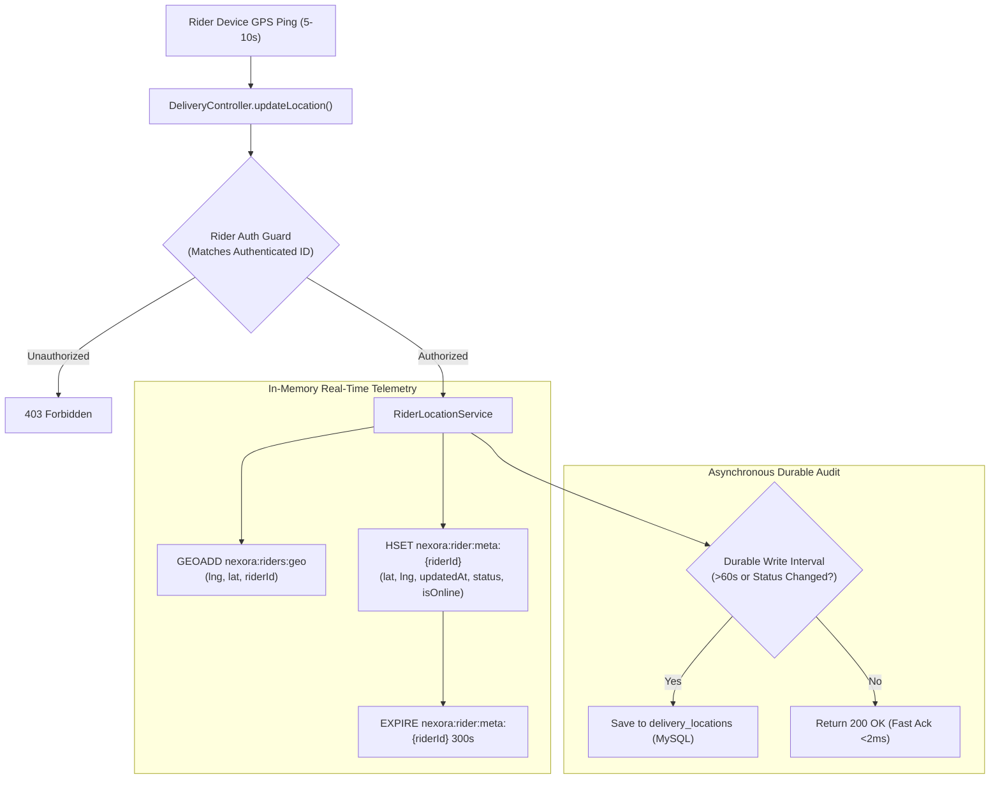

# NEXORA 3.0 — PHASE 2 REDIS GEOSPATIAL DESIGN

## 1. Problem Statement
In NEXORA 2.0, rider location updates (`POST /api/v1/delivery/location`) wrote directly to the MySQL `delivery_locations` table on every GPS ping.
- High-frequency GPS updates (every 5–10 seconds per active rider) generated hundreds of database writes per minute.
- In production with a 20-connection Hikari pool, checkout and payment transactions suffered from database connection starvation.
- Proximity queries required spatial SQL table scans on MySQL.

---

## 2. Redis Geospatial Architecture

---

## 3. Data Structures & Key Schemas

### 3.1. Spatial Index (`GEOADD` / `GEOSEARCH`)
- **Key:** `nexora:riders:geo`
- **Member:** Rider ID string (e.g., `"201"`)
- **Coordinates:** `longitude, latitude` (Redis uses longitude first, then latitude)
- **Query:** `GEOSEARCH nexora:riders:geo FROMLONLAT {lng} {lat} BYRADIUS {radiusKm} km WITHDIST WITHCOORD`

### 3.2. Telemetry Metadata Hash
- **Key:** `nexora:rider:meta:{riderId}`
- **TTL:** 300 seconds (5 minutes of inactivity auto-evicts telemetry).
- **Fields:**
  - `riderId`: Long
  - `latitude`: Double
  - `longitude`: Double
  - `status`: String (`AVAILABLE`, `BUSY`, `OFFLINE`)
  - `isOnline`: Boolean (`true` / `false`)
  - `updatedAt`: Long epoch milliseconds
  - `batteryLevel`: Integer (optional)

### 3.3. Stale Location Detection
A rider's telemetry is classified into three freshness tiers:
- **FRESH (< 30s):** Highly accurate, eligible for immediate high-confidence dispatch and real-time customer tracking.
- **ACCEPTABLE (30s – 90s):** Eligible for dispatch candidate filtering with medium confidence.
- **STALE (> 90s):** Disqualified from automatic dispatch. The customer tracking UI displays an amber warning badge stating the rider GPS signal is delayed.

---

## 4. Privacy, Security & Authorization Rules
1. **Rider Self-Update Only:** Delivery partners can only publish coordinates for their own authenticated user ID.
2. **Order-Bound Customer Access:** Customers can query live rider location *only* for the rider assigned to their active order, and *only* between states `RIDER_ASSIGNED` and `DELIVERED`.
3. **No Unbounded Storage:** Transient GPS pings expire from Redis after 5 minutes of inactivity; historical breadcrumb routes are not retained unnecessarily.

---

## 5. Resilient Fallback Strategy
If Redis is down or unreachable:
1. `RiderLocationService` catches connection exceptions gracefully without throwing exceptions to riders or checkouts.
2. Nearby rider discovery degrades to MySQL `DeliveryPartnerRepository.findByStatusAndIsOnlineTrue()` using the last known coordinates recorded in `delivery_partners`.
3. Logs Redis connection warnings without crashing the Spring Boot application context.
