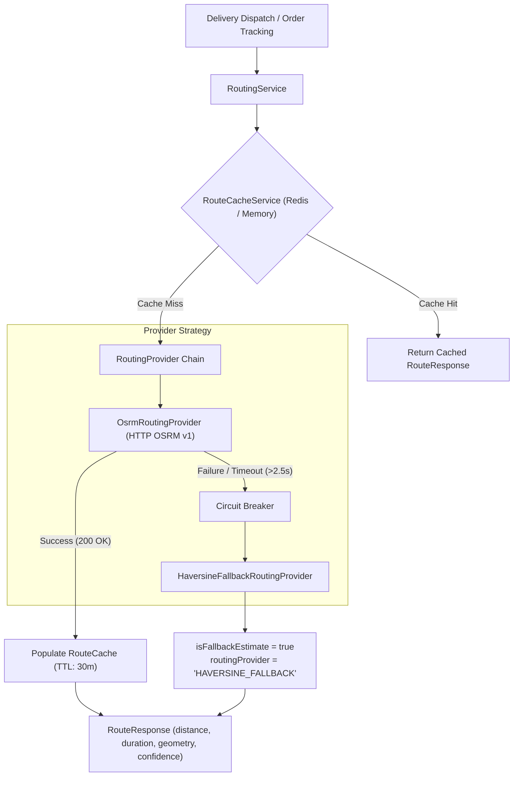

# NEXORA 3.0 — PHASE 2 ROUTING ARCHITECTURE

## 1. Overview
The **NEXORA Intelligent Routing Engine** transitions the platform from straight-line Haversine approximations to a resilient, road-network routing provider abstraction powered by **OSRM (Open Source Routing Machine)**.

Quick commerce promises 10–15 minute deliveries. Haversine distance fails in real-world urban topologies due to:
- One-way streets and traffic dividers.
- Flyovers, railway crossings, and canal crossings (frequent in cities like Ahmedabad).
- Real road network distance typically being 1.25x to 1.6x longer than straight-line distance, but with non-linear variance depending on urban density.

---

## 2. Core Architecture



---

## 3. Component Design

### 3.1. RoutingProvider (Interface)
```java
public interface RoutingProvider {
    RouteResponse calculateRoute(RouteRequest request);
    String getProviderName();
    boolean isAvailable();
}
```

### 3.2. OsrmRoutingProvider (Implementation)
- **Protocol:** HTTP REST GET to `/route/v1/{profile}/{lon1},{lat1};{lon2},{lat2}?overview=simplified&geometries=polyline`
- **Profiles Supported:** `driving`, `bike`
- **Configurable Base URL:** `${nexora.routing.osrm.base-url:https://router.project-osrm.org}`
- **Connect Timeout:** 2,000 ms
- **Read Timeout:** 2,500 ms
- **Error Handling:** ConnectException, SocketTimeoutException, 4xx, 5xx caught cleanly and routed to fallback.
- **Circuit Breaker:** Tracks recent consecutive failure count; temporarily trips to fallback when OSRM is unreachable to prevent request thread pool exhaustion.

### 3.3. HaversineFallbackRoutingProvider (Graceful Degradation)
- Invoked when OSRM is unreachable, unconfigured, or timed out.
- Computes Haversine great-circle distance.
- Uses urban courier velocity ($20\text{ km/h}$ average in dense traffic) to estimate transit seconds.
- Explicitly sets `isFallbackEstimate = true` and `routingProvider = "HAVERSINE_FALLBACK"`.
- Never masquerades straight-line calculations as real road routing.

### 3.4. RouteCacheService
- **Key Scheme:** `nexora:route:{profile}:{lat1,4}:{lng1,4}:{lat2,4}:{lng2,4}`
- Coordinate precision rounded to 4 decimal places (~11 meters), ensuring high cache hit rates for frequent dark-store-to-neighborhood delivery paths without sacrificing resolution.
- **Storage:** Redis when available; resilient bounded LRU memory fallback if Redis is disconnected.
- **TTL:** 1,800 seconds (30 minutes).

---

## 4. Configuration Properties
```properties
# Routing Engine Configuration
nexora.routing.provider=osrm
nexora.routing.osrm.base-url=${OSRM_BASE_URL:https://router.project-osrm.org}
nexora.routing.osrm.profile=driving
nexora.routing.osrm.connect-timeout-ms=2000
nexora.routing.osrm.read-timeout-ms=2500
nexora.routing.cache.ttl-seconds=1800
nexora.routing.fallback.average-speed-kmh=20.0
```
