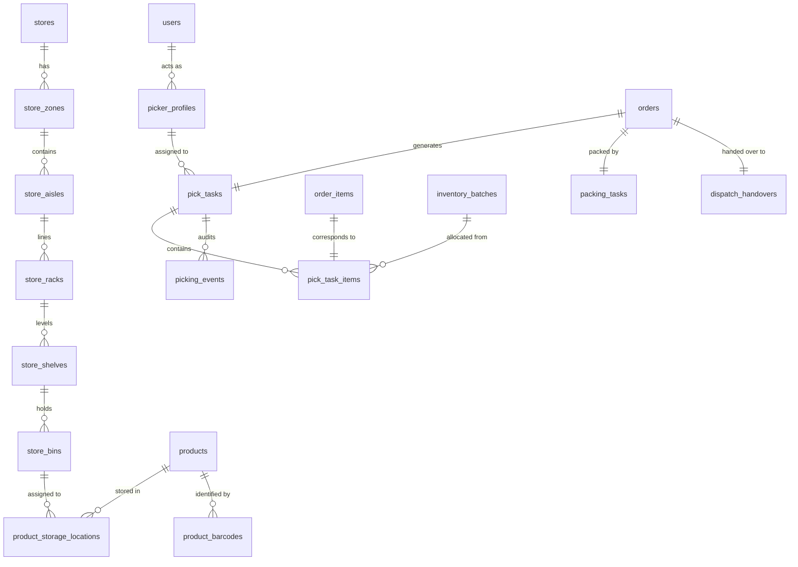

# NEXORA 3.0 — PHASE 3 DATABASE DESIGN SPECIFICATION

**Schema Migration:** `V8__dark_store_wms_layout_and_picking.sql`  
**Database Engine:** TiDB Cloud MySQL 8.0 Compatible / H2 in-memory test  
**Target Tables:** 13 new tables, 2 alter statements, composite indexes

---

## 1. Entity-Relationship Model

---

## 2. Table Specifications

### Layout Entities
1. **`store_zones`**: Zones by temperature requirement (`ZONE-AMBIENT`, `ZONE-COLD`, `ZONE-FROZEN`).
   - Indexes: `store_id`, `(store_id, zone_code)` UNIQUE.
2. **`store_aisles`**: Corridors with sequence number, width, length, direction, and restricted flags.
   - Indexes: `zone_id`, `store_id`, `(store_id, aisle_code)` UNIQUE.
3. **`store_racks`**: Modular shelving units positioned along the aisle (side: `LEFT`, `RIGHT`).
   - Indexes: `aisle_id`, `store_id`, `(aisle_id, rack_code)` UNIQUE.
4. **`store_shelves`**: Vertical shelf tiers (`1` bottom to `4` top).
   - Indexes: `rack_id`, `store_id`, `(rack_id, shelf_code)` UNIQUE.
5. **`store_bins`**: Atomic pick coordinates $(X, Y)$ and traversal sequence index.
   - Indexes: `shelf_id`, `store_id`, `(store_id, traversal_sequence)`, `full_location_code` UNIQUE.
6. **`product_storage_locations`**: Many-to-many product-bin mapping with `is_primary` flag.
   - Indexes: `product_id`, `bin_id`, `store_id`, `(product_id, bin_id)` UNIQUE.
7. **`product_barcodes`**: Multiple scannable identifiers per product (EAN-13, SKU, QR).
   - Indexes: `product_id`, `barcode_value` UNIQUE.

### Execution & Audit Entities
8. **`picker_profiles`**: Picker operational state (`AVAILABLE`, `BUSY`, `ON_BREAK`, `OFFLINE`).
   - Indexes: `user_id` UNIQUE, `store_id`, `status`.
9. **`pick_tasks`**: Order picklist with traversal metrics, algorithm choice, and timestamps.
   - Indexes: `order_id` UNIQUE, `store_id`, `picker_id`, `status`.
10. **`pick_task_items`**: Sequenced pick lines linking `order_item_id`, `bin_id`, and FEFO `batch_id`.
    - Indexes: `pick_task_id`, `order_item_id`, `product_id`, `bin_id`, `batch_id`.
11. **`picking_events`**: Immutable audit log of every barcode scanned during picking.
    - Indexes: `pick_task_id`, `operator_id`.
12. **`packing_tasks`**: Bag sealing and QC checklists.
    - Indexes: `order_id` UNIQUE, `store_id`.
13. **`dispatch_handovers`**: Verified handover timestamp from store packer to delivery rider.
    - Indexes: `order_id` UNIQUE, `delivery_partner_id`.
