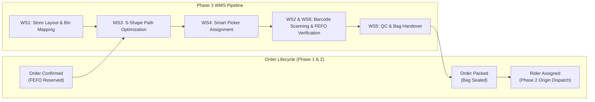

# NEXORA 3.0 — PHASE 3: DARK STORE WMS ARCHITECTURE SPECIFICATION

**Module:** Dark Store Warehouse Management System (WMS)  
**Target Branch:** `feature/nexora-phase3-dark-store-wms`  
**Architectural Baseline:** Phase 1 (Inventory Reservation & FEFO) + Phase 2 (OSRM Routing & Redis Geospatial Tracking)  
**Domain Standard:** Blinkit-Grade Dark Store Fulfillment (Sub-3 Minute Pick-and-Pack Invariant)

---

## 1. Executive Architecture Summary

NEXORA 3.0 Phase 3 transforms the platform from a basic store order queue into an industrial-grade **Dark Store Warehouse Management System (WMS)**. In quick commerce platforms operating under 10-minute delivery guarantees, in-store operations must adhere to a strict **3-minute pick-and-pack budget**:
- **0–30s:** Automated order splitting, FEFO reservation binding, S-Shape picklist sequencing, and smart picker assignment.
- **30s–120s:** Barcode/QR-guided S-shape wave picking across pre-indexed aisle bins.
- **120s–180s:** Quality inspection, bag sealing, and automated dispatch handover to the Phase 2 delivery engine.

---

## 2. Six Core Workstreams

### WS1 — Dark Store Layout and Bin Location Management
- **Hierarchy:**
  $$\text{Store} \longrightarrow \text{Zone} \longrightarrow \text{Aisle} \longrightarrow \text{Rack} \longrightarrow \text{Shelf} \longrightarrow \text{Bin} \longrightarrow \text{Product Inventory}$$
- **Location Codes:** Standardized format `ST{storeId}-Z{zoneCode}-A{aisle}-R{rack}-S{shelf}-B{bin}` (e.g. `ST04-ZAMB-A01-R01-S02-B01`).
- **Traversal Ordering:** Every bin is assigned a sequential traversal index based on warehouse coordinates $(X, Y)$ and aisle traversal direction.
- **Product Mapping:** Supports primary picking bins and secondary overflow bins with capacity thresholds.

### WS2 — Product Barcode & QR Scanning
- **Scanner Engine:** Supports EAN-13, UPC-A, internal SKU barcodes, and QR code payloads.
- **Verification Rule:** Every scanned barcode must match the expected product, the order store, and the FEFO-reserved batch.
- **Auditing:** Emits immutable `PickingEvent` logs capturing operator ID, scanned payload, result (`SUCCESS`, `WRONG_PRODUCT`, `WRONG_STORE`, `EXPIRED_BATCH`, `EXCESS_QUANTITY`), and timestamp.

### WS3 — S-Shape and Optimized Pick-Path Engine
- **Serpentine Traversal:**
  - Evaluates all aisles containing requested order items.
  - Skips empty aisles.
  - Alternates traversal directions between consecutive non-empty aisles:
    - Even aisle: Enter front ($Y=0$), traverse ascending to back ($Y=L$).
    - Odd aisle: Enter back ($Y=L$), traverse descending to front ($Y=0$).
  - Avoids double-backs, turning loops, and unnecessary aisle reversals.
- **Nearest-Neighbor Fallback:**
  - Evaluates greedy Euclidean/Manhattan distance for small single-item or double-item orders, dynamically selecting whichever algorithm yields shorter walking distance.

### WS4 — Smart Picker Assignment & Picklist Management
- **Picker Profile:** Real-time state machine (`AVAILABLE`, `BUSY`, `ON_BREAK`, `OFFLINE`), active workload counter, and historical picking velocity ($s/\text{item}$).
- **Assignment Engine:** Automatically assigns confirmed orders to the least-burdened, available picker in the store using transaction-safe locks.
- **PickTask & PickTaskItem:** Organizes items in strict S-Shape sequence with bin location indicators and real-time pick state tracking (`PENDING`, `PICKED`, `SHORTAGE`, `SUBSTITUTED`).

### WS5 — Packing, Quality Control and Dispatch Handover
- **Packing QC Station:** Validates that 100% of order items are resolved (`PICKED` or approved `SHORTAGE`/`SUBSTITUTED`).
- **Bag Sealing:** Associates the order with a physical barcode bag code (`BAG-XXXXXX`).
- **Handover to Delivery:** Automatically transitions order to `READY` and triggers Phase 2 `DeliveryService.assignNearestRider()`.

### WS6 — FEFO Batch-Aware Picking & Consistency
- **Phase 1 Linkage:** Directly consumes `batch_id` from `InventoryReservation` populated during checkout.
- **Expiry Enforcement:** Enforces strict non-expired batch picking. Rejects any batch where $\text{expiryDate} \le \text{today}$.
- **Consistency Ledger:** Decrements batch reserved and available quantities upon packing completion, guaranteeing 0 overselling or double-allocation.
