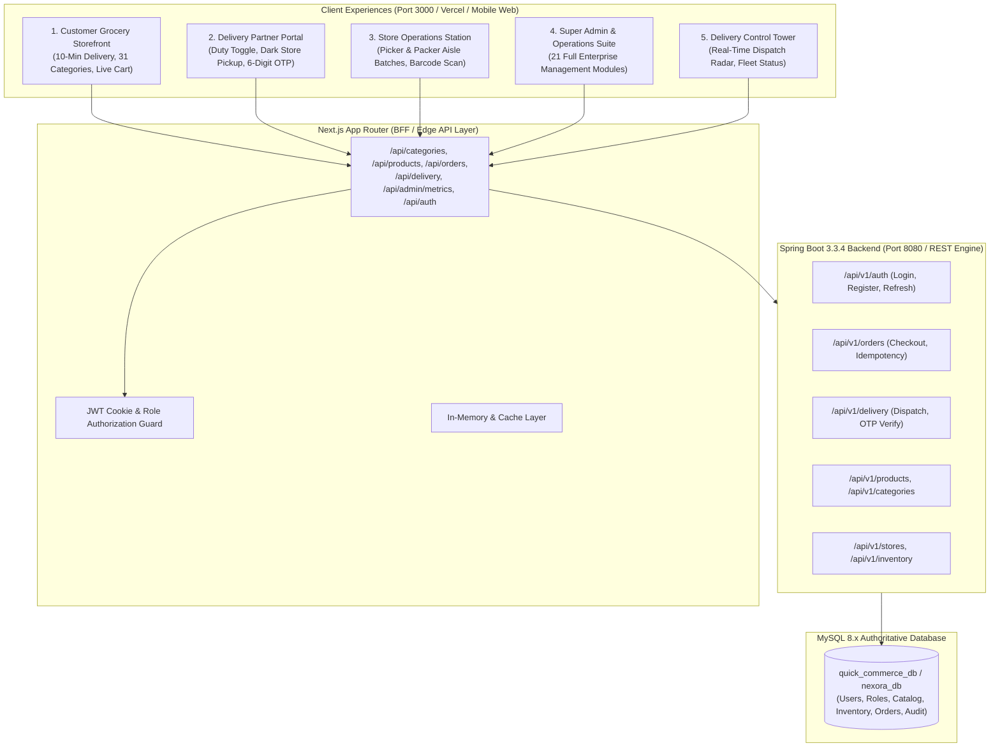

# NEXORA — MASTER REBUILD ARCHITECTURE PLAN

**Target Project:** `F:\Nexora`  
**Git Branch:** `rebuild/quick-commerce`  
**Production Target:** `main` (auto-deployed to Vercel)  
**Author:** Principal Software Architect & DevOps Lead  
**Date:** October 2026  

---

## 1. Executive Summary & Root Cause Analysis

### The "Old Dashboard" Issue Solved
* **Root Cause:** The old dark-mode engineering dashboard was being served directly by Spring Boot from `backend/src/main/resources/static/index.html` on port 8080.
* **The New Storefront:** The modern Blinkit-style quick commerce storefront lives in `frontend/src/app/page.tsx` on Next.js 14 (Port 3000 / Vercel).
* **Action:**
  1. Safely archive all legacy Phase 1–28 demo HTML files (`index.html`, `loadtesting.html`, `monitoring.html`, etc.) to `docs/legacy-demo-pages/`.
  2. Replace `backend/src/main/resources/static/index.html` with a branded Nexora Quick-Commerce API Portal that cleanly redirects browser users to the live Next.js Storefront (`http://localhost:3000`) and provides Swagger/REST documentation.
  3. Ensure the primary customer entry point on Vercel and local dev is the full Next.js customer web storefront.

---

## 2. Target System Architecture

---

## 3. Brand Identity Tokens (Mandatory Specification)

* **Leaf Green (Primary):** `#176B45` — Brand navigation, headings, primary CTA buttons, active tabs.
* **Zesty Lime (Accent):** `#D8F36A` — Discount tags (`35% OFF`), cart highlight badge, motion sparks. Text on lime must be Forest Ink (`#173327`).
* **Fresh Cream (Background):** `#F7F8F2` — Main canvas background for high readability and warmth.
* **Forest Ink (Text):** `#173327` — High contrast body and heading typography.
* **Surface White:** `#FFFFFF` — Product cards, modal sheets, checkout containers (`border: #E3E8DE`, `shadow: 0 4px 16px rgba(23, 51, 39, 0.06)`).

---

## 4. Phase-by-Phase Execution Roadmap

1. **Phase 1: Audit, Branch Setup & Legacy Decoupling**
   - Create `rebuild/quick-commerce` branch.
   - Archive legacy static HTML pages from `backend/src/main/resources/static/` to `docs/legacy-demo-pages/`.
   - Replace root backend static page with branded Nexora API Portal.
2. **Phase 2: Brand Foundation & Design System Consolidation**
   - Ensure all logo assets in `frontend/public/assets/brand/` are true scalable vector SVGs.
   - Centralize tokens in `globals.css` and `tailwind.config.js`.
3. **Phase 3: Database & Backend Foundation**
   - Verify MySQL connection and Flyway migrations in `database/schema/V1__init_quick_commerce_schema.sql`.
   - Ensure Spring Boot builds cleanly with Java 21 and Maven.
4. **Phase 4: Customer Storefront Production Readiness**
   - Real catalog integration, live search autocomplete, slide-out cart drawer, coupon `NEXORA50`, Razorpay/COD checkout modal, and 5-stage order progress tracking.
5. **Phase 5: Delivery Partner Experience & OTP Verification**
   - On/Off duty toggle, Dark Store pickup checklist, 6-digit OTP doorstep verification, earnings tracker.
6. **Phase 6: Store Operations (Picker & Packer Station)**
   - Aisle batch queue, barcode scanning simulation, bag sealing.
7. **Phase 7: Complete 21-Module Super Admin & Control Tower**
   - Real data tables, order management center, partner management, catalog CMS, inventory alerts, and immutable audit logs.
8. **Phase 8: Build Verification, Git Commit & Vercel Sync**
   - Full `npm run build` verification.
   - Safe Git commit and synchronization with GitHub and Vercel.
